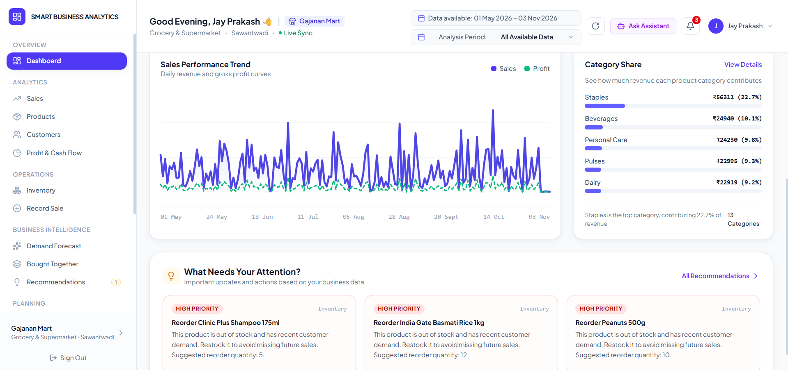
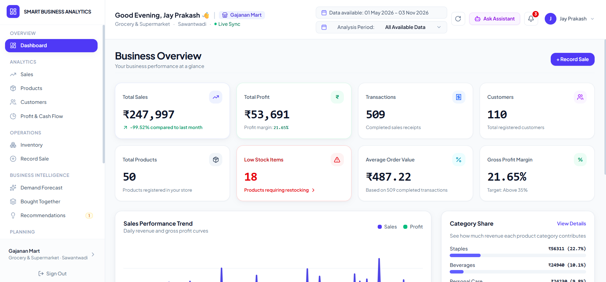
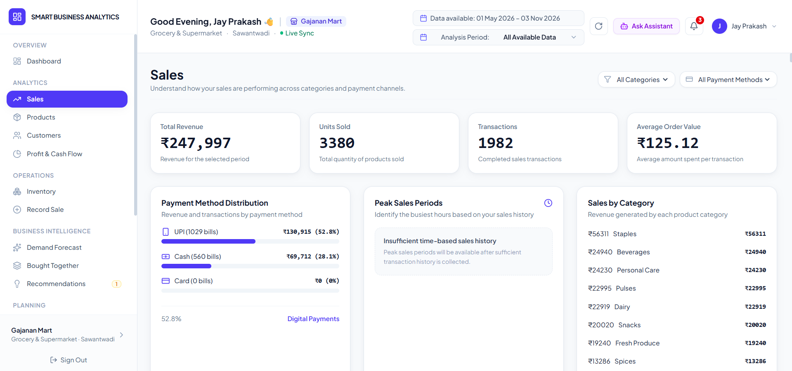
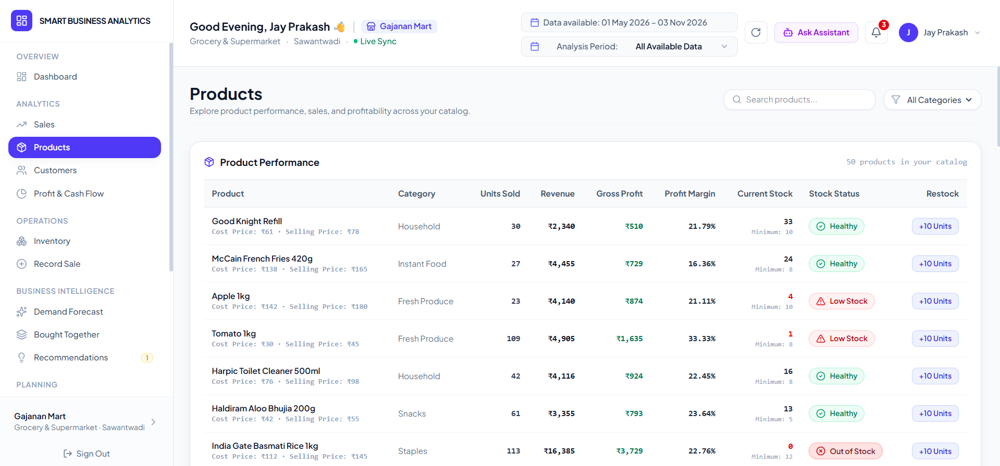
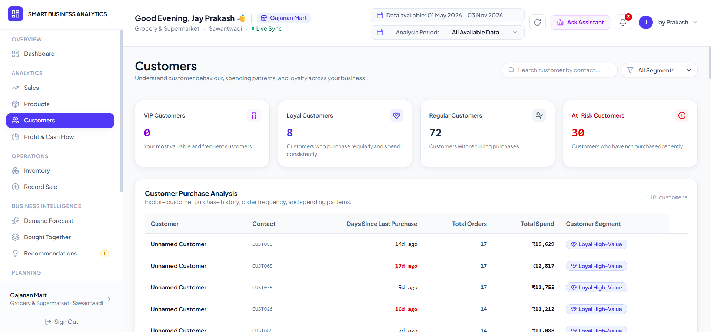
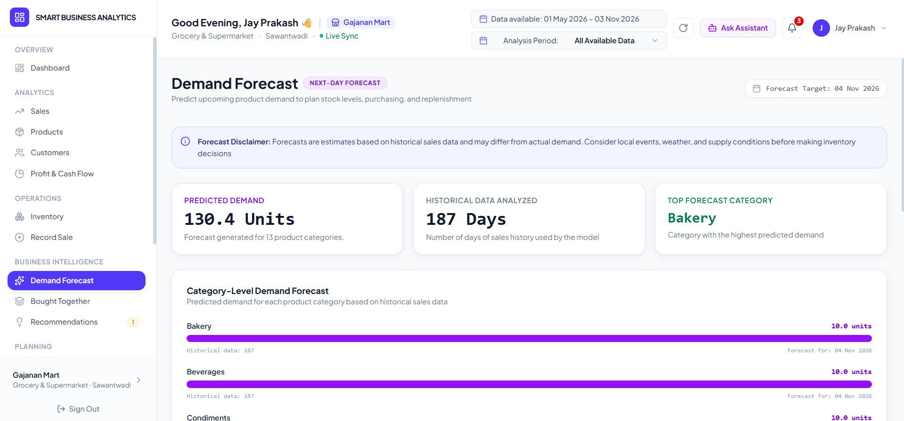
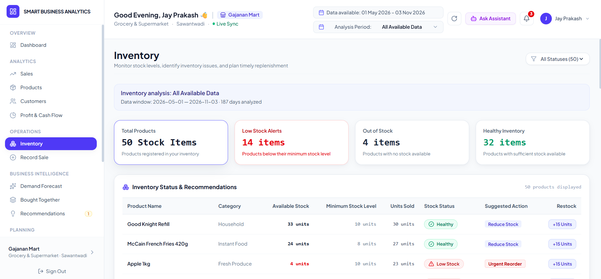
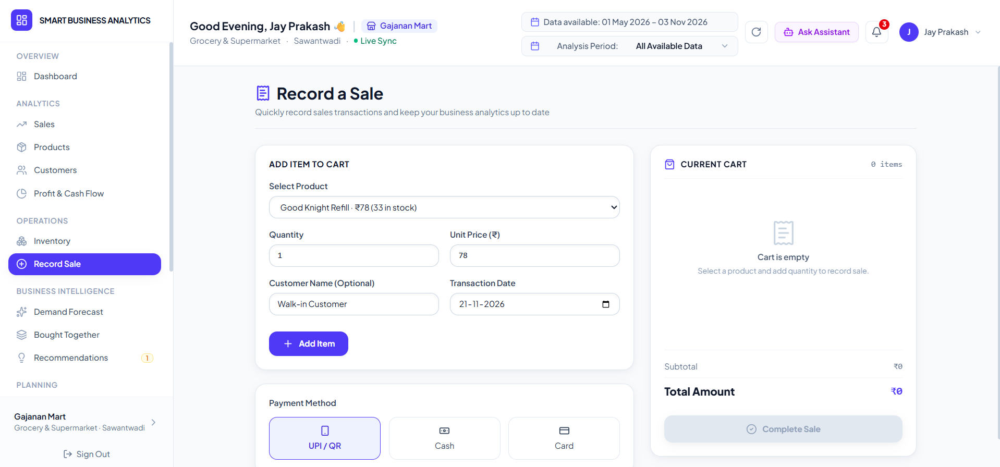

# Smart Business Analytics
### Final Year Project | B.Sc. Data Science

**Turn business data into smarter decisions!**

A powerful analytics platform for small and medium-sized businesses and online retailers to track sales, uncover profit insights, understand customers, manage inventory, and predict future demand—all in one place.

---

## Live Demo & Getting Started

Want to explore how Smart Business Analytics works? Visit the live application:

**[Open Smart Business Analytics](https://smart-business-analytics-delta.vercel.app)**

### Accessing the Application

Users must log in or create a new account to access the platform.

For visitors who want to explore the application's features, a pre-configured demo account is provided below.

**Demo Account Credentials**

| Field | Details |
|---|---|
| Email | gajananmart2026@gmail.com|
| Password | GajananMart@2026! |

> **Note:** These credentials are provided for demonstration purposes only. Please avoid changing account settings or deleting existing demo data.

### Steps to Explore the Website

1. Open the live application.
2. Navigate to the Login page.
3. Enter the provided demo account credentials.
4. After successful login, explore the business dashboard.
5. Navigate through the available sections to explore sales analytics, profitability, customer insights, inventory and demand forecasting.
6. Try the Business Assistant to explore business-related insights.

### Important Loading Notice

The application may take a little time to load initially. Dashboard values, charts, analytics and machine learning results are retrieved and processed from the backend.

Please allow a few moments for the data to load completely before navigating to another section or refreshing the page.

---

## Project Objectives

The main objectives of Smart Business Analytics are:

- **Simplify Business Management:** Provide a centralized platform for managing business transactions and billing.
- **Analyse Sales Performance:** Help business owners understand sales trends and identify business performance patterns.
- **Evaluate Profitability:** Analyse revenue, costs and profits to understand product-wise financial performance.
- **Understand Customer Behaviour:** Identify customer segments and purchasing patterns using data analytics.
- **Improve Inventory Management:** Monitor stock levels and identify potential inventory issues.
- **Forecast Product Demand:** Use machine learning techniques to estimate future product demand.
- **Support Data-Driven Decisions:** Generate meaningful insights and recommendations to help businesses make informed decisions.

---

## Key Features

Smart Business Analytics provides a range of tools to help businesses manage, analyse and understand their operations.

| Feature | Description |
|---|---|
| **Business Dashboard** | Displays important business performance indicators and summarizes overall business activity. |
| **Data Management** | Allows users to import business data through CSV/Excel files or enter transactions manually. |
| **Billing & Receipts** | Enables users to create bills and generate printable receipts. |
| **Sales Analytics** | Analyses sales trends and provides insights into business performance. |
| **Product Profitability** | Evaluates product-wise revenue, costs, profit and profit margins. |
| **Customer Insights** | Analyses customer purchasing behaviour and identifies customer segments. |
| **Inventory Intelligence** | Monitors stock levels and identifies low-stock and overstock situations. |
| **Demand Forecasting** | Uses machine learning to predict future product demand. |
| **Market Basket Analysis** | Identifies products that are frequently purchased together. |
| **Business Recommendations** | Provides actionable suggestions based on available business data. |
| **Goals & Targets** | Allows businesses to set and monitor performance goals. |
| **Pricing Scenarios** | Helps explore potential pricing changes and their impact on profitability. |
| **Business Assistant** | Provides a conversational interface for asking questions about business data. |
| **Downloadable Reports** | Allows users to export business reports for further analysis. |

---

## Technology Stack

The application is developed using modern web technologies, backend frameworks and machine learning libraries.

### Frontend
- **React** – For building the interactive user interface.
- **TypeScript** – For structured and type-safe frontend development.
- **CSS** – For styling and responsive layouts.

### Backend
- **Python** – For backend logic and data processing.
- **FastAPI** – For building backend APIs and handling application requests.

### Data Processing & Machine Learning
- **Pandas** – For data manipulation and analysis.
- **NumPy** – For numerical computations.
- **Scikit-learn** – For implementing machine learning models.

### Database
- **SQLite** – Used for local development.
- **Turso** – Used as the production database.

### Deployment & Version Control
- **Vercel** – For application deployment.
- **GitHub** – For source control and project showcase.

---

## Machine Learning & Analytics

Smart Business Analytics integrates machine learning algorithms and data analysis techniques to transform historical business data into meaningful insights.

### 1. Demand Forecasting
- Uses the **Extra Trees Regressor** algorithm.
- Analyses historical sales patterns and related time-based features.
- Estimates future product demand to support inventory planning.

### 2. Customer Segmentation
- Uses **RFM Analysis** (Recency, Frequency and Monetary Value).
- Applies **K-Means Clustering** to group customers based on their purchasing behaviour.
- Helps identify customer groups such as loyal, regular and high-value customers.

### 3. Market Basket Analysis
- Uses the **Apriori Algorithm**.
- Identifies products that are frequently purchased together.
- Helps businesses understand product associations and explore cross-selling opportunities.

These techniques help businesses gain deeper insights into sales patterns, customer behaviour and product demand.

---

## Application Screenshots

Explore the interface and key functionalities of Smart Business Analytics through the screenshots below.

### 1. Business Dashboard

### 2. Sales Analytics

### 3. Product Profitability

### 4. Customer Insights

### 5. Demand Forecasting

### 6. Inventory Intelligence

### 7. Manual Billing

---

## Deployment

Smart Business Analytics is deployed using Vercel, with Turso providing the production database.

The application is hosted online and can be accessed through the live demo provided above.

## Project Scope & Limitations

- The accuracy of business insights depends on the quality and availability of input data.
- Machine learning predictions are estimates and may differ from actual business outcomes.
- Certain analytical features require sufficient historical transaction data.
- Initial loading of dashboard values, charts and analytical results may take some time.

## Future Enhancements

- Expansion of business-specific analytics and features for different business categories.
- Improvements in demand forecasting techniques.
- Enhanced customer behaviour analysis.
- Additional business performance indicators and reporting options.
- Further improvements to application performance and user experience.

## Project Information

| Detail | Information |
|---|---|
| Project Name | Smart Business Analytics |
| Project Type | Final Year Academic Project |
| Degree | B.Sc. Data Science |
| Domain | Data Analytics & Machine Learning |

---

## Conclusion

Smart Business Analytics demonstrates how data analytics and machine learning can transform everyday business transactions into meaningful insights, helping small and medium-sized businesses make more informed decisions.

---

**Built to help businesses turn everyday transactions into meaningful insights.**

